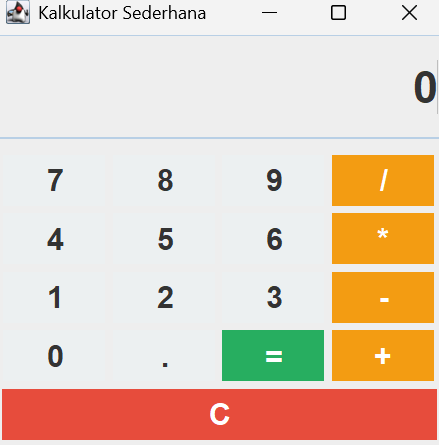
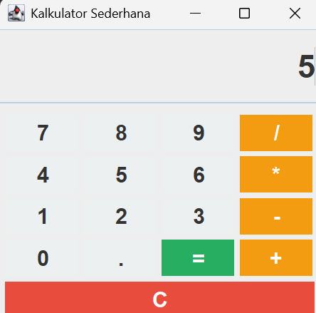
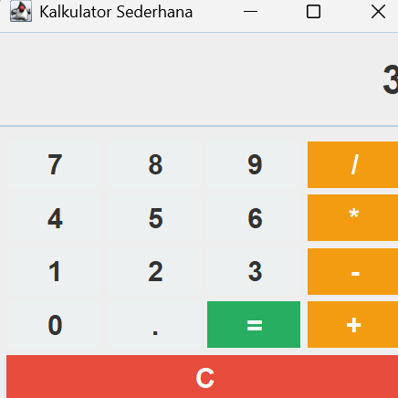
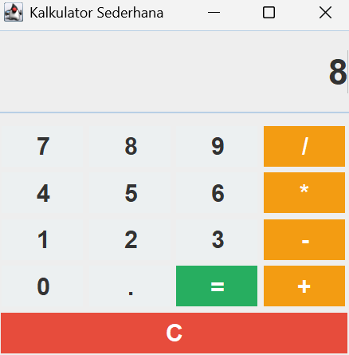

# TugasPBO

# Kalkulator Sederhana

## Nama: Baiq Febylia Eka Ningrum
## NIM: F1D0241019

---

## 1. Deskripsi Aplikasi

Kalkulator Sederhana adalah aplikasi GUI berbasis Java Swing untuk melakukan operasi hitung dasar: penjumlahan, pengurangan, perkalian, dan pembagian. Angka dapat dimasukkan dengan mengklik tombol atau mengetik lewat keyboard.

## 2. Fitur

- Operasi tambah (`+`), kurang (`-`), kali (`*`), dan bagi (`/`).
- Bilangan desimal (tombol `.`).
- Tombol `C` untuk menghapus semua.
- Input lewat keyboard (angka, operator, `Enter` untuk `=`, dan `C`).
- Pesan `Error` jika terjadi pembagian dengan nol.

## 3. Lima Komponen Utama GUI

| No | Komponen | Class / Interface yang digunakan | Fungsi di aplikasi |
|---|---|---|---|
| 1 | Top-level Container | `JFrame` (class) | Jendela utama kalkulator |
| 2 | Intermediate Container | `JPanel` (class) | Mengelompokkan tombol angka/operator dan tombol Clear |
| 3 | Atomic Component | `JTextField`, `JButton` (class) | Layar hasil dan tombol-tombol kalkulator |
| 4 | Layout | `BorderLayout`, `GridLayout` (class, implements `LayoutManager`) | Mengatur posisi komponen |
| 5 | Event Listener | `ActionListener` (interface), `KeyAdapter` (adapter class) | Menangani klik tombol dan ketikan keyboard |

### 3.1 Top-level Container: `JFrame`
`JFrame` adalah wadah utama yang menampung semua komponen lain. Class `Kalkulator` meng-extend `JFrame`, dan `setDefaultCloseOperation(JFrame.EXIT_ON_CLOSE)` membuat program berhenti saat jendela ditutup.

### 3.2 Intermediate Container: `JPanel`
`JPanel` adalah wadah perantara untuk mengelompokkan komponen. Aplikasi ini memakai dua panel: `panelTombol` (berisi 16 tombol angka dan operator) dan `panelBawah` (berisi tombol `C`).

### 3.3 Atomic Component
- `JTextField` (`layar`): menampilkan angka dan hasil. Dibuat tidak bisa diedit langsung (`setEditable(false)`).
- `JButton`: tombol angka `0-9`, titik, operator `+ - * /`, `=`, dan `C`.

### 3.4 Layout
- `BorderLayout`: dipakai pada `JFrame` (layar di `NORTH`, tombol di `CENTER`, tombol `C` di `SOUTH`).
- `GridLayout(4, 4)`: dipakai pada `panelTombol` agar 16 tombol tersusun rapi 4 baris × 4 kolom dengan ukuran sama.

### 3.5 Event Listener
- `ActionListener` (interface): class `Kalkulator` meng-implements interface ini dan meng-override method `actionPerformed(ActionEvent e)`. Method ini dipanggil saat tombol diklik, lalu `e.getActionCommand()` dipakai untuk mengetahui teks tombol yang diklik.
- `KeyAdapter` (adapter class): dipasang pada `layar` lewat anonymous class dan meng-override `keyTyped(KeyEvent e)` untuk membaca ketikan keyboard. Adapter dipakai agar tidak perlu menulis ketiga method `KeyListener` (`keyTyped`, `keyPressed`, `keyReleased`), cukup yang dibutuhkan.

Keduanya memanggil method `proses(String perintah)` yang sama, sehingga klik tombol dan ketikan keyboard menghasilkan perilaku yang sama.

## 4. Cara Menjalankan

```bash
javac Kalkulator.java
java Kalkulator
```

## 5. Struktur Proyek

```
TUGAS-GUI/
├── Kalkulator.java
├── README.md
├── .gitignore
└── screenshot/
    ├── awal.png
    └── hasil.png
```

## 6. Screenshot

### Tampilan Awal


### Tampilan Awal


### Tampilan Awal


### Hasil Perhitungan


